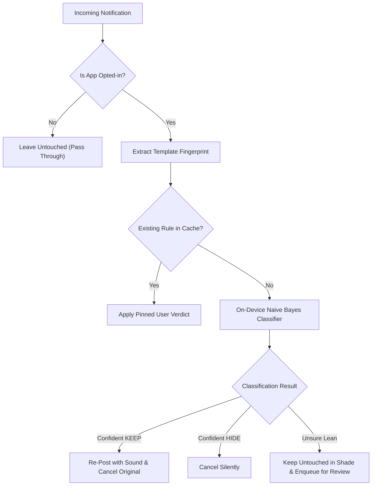

# NotifFilter

[-3DDC84?logo=android&logoColor=white)](https://developer.android.com)
[](https://kotlinlang.org)
[](https://developer.android.com/compose)
[-brightgreen?logo=shield)](file:///Users/ykanagaraj/Downloads/Personal%20Projects/notiffilter/app/src/main/AndroidManifest.xml)
[](LICENSE)

An intelligent, 100% offline Android notification filter that learns from your decisions to silence marketing spam while ensuring important alerts (order updates, delivery tracking, critical status) always ring through.

---

## The Problem

Modern consumer apps (food delivery like Swiggy/Zomato, quick-commerce like Blinkit/Zepto, cab aggregators, shopping apps) mix a few essential alerts into an endless barrage of promotional marketing:

- **What you care about:** *"Order out for delivery"*, *"Driver is arriving"*, *"OTP / Account Security"*
- **What clutters your shade:** *"Craving Biryani? 50% OFF!"*, *"Weekend treat just for you 🎉"*, *"Hurry, discounts expiring!"*

Handcrafted keyword rules fail because marketing copy is constantly reworded. Muting the whole app causes you to miss critical updates. **NotifFilter solves this by learning the difference right on your device.**

---

## Key Highlights & Guarantees

- 🛡️ **Zero Network Access (Guaranteed by Android OS):** The app manifest deliberately omits `<uses-permission android:name="android.permission.INTERNET" />`. The operating system physically refuses to let the app open a socket. Your notifications cannot leave your device.
- ⚡ **Zero Cloud & Zero API Keys:** Operates via a fast, lightweight on-device Naive Bayes model. Classifications execute locally in under 1 millisecond with zero external dependencies.
- 🔕 **Selective Notification Sound:** Mute noisy apps in Android Settings once; NotifFilter re-posts and rings **only** for keepers.
- 🎯 **Observe First, Filter Second:** New apps start in observation mode without altering notifications, letting you train the model safely before enabling filtering.
- 🔒 **Fail-Safe (Optimistic Show):** If anything is uncertain or fails, the notification is shown normally. Nothing is ever lost or silently suppressed by mistake.

---

## How It Works



### The Decision Table

| Verdict | Certainty | What Happens |
|---|---|---|
| **KEEP** | Confident or Leaning | **Re-posted on a loud channel** with sound and vibration |
| **HIDE** | Confident | **Cancelled silently** from the notification shade |
| **HIDE** | Leaning (Unsure) | **Left untouched in the shade** (silent & intact), added to review queue |

> **Why Keepers Get Re-Posted:**  
> On Android, third-party apps cannot silence another app's notification before it plays sound. The solution: set the source app's channels to **Silent** once in Android Settings. When NotifFilter detects a keeper, it immediately re-posts it onto its own loud channel with audio.

---

## Quick Start & How to Use

### 1. Installation
Install the APK on your device running Android 8.0 (Oreo) or higher.

### 2. Grant Initial Permissions
When opening the app for the first time, you will be guided to grant:
1. **Notification Listener Access:** Required to read incoming notifications and dismiss filtered ones.
2. **Battery Optimization Exemption:** Necessary to keep the background listener alive.
3. **Auto-Start / Background Execution (on ColorOS, MIUI, OxygenOS, HyperOS, etc.):** Lock NotifFilter in recent apps and enable auto-start in system settings so aggressive OEM battery managers do not kill the listener.

### 3. Add an App in Observe Mode
1. Tap **+ Add App** on the home screen and choose an app (e.g., Swiggy, Blinkit, Uber).
2. The app is added in **Observing** status:
   - Notifications are **not** hidden or modified.
   - NotifFilter collects templates and logs incoming notifications in the background.

### 4. Review & Train the Queue
1. After a few days of normal usage, open NotifFilter.
2. Go to the **Queue** screen (or tap the silent notification summary: *"X templates need your verdict"*).
3. Review each template and tap **Keep** or **Hide**.
   - Your choices create permanent pinned rules and train the on-device model.

### 5. Activate Active Filtering
1. Tap on the app in NotifFilter and toggle status from **Observing** to **Active Filtering**.
2. Follow the in-app shortcut to open the target app's system notification channel settings.
3. Set the target app's promotional channels to **Silent / No Sound**.
4. That's it! NotifFilter will now automatically silence marketing junk and ring out loud whenever an important notification arrives.

---

## Architectural & Technical Details

### Token Counting vs. Static Keywords
Keyword rules are brittle: a single phrase mismatch fails to classify promotional text. NotifFilter weighs individual token evidence and retrains dynamically with every user confirmation. Marketing language shifts its vocabulary often, but its structure (imperatives, percentages, urgency, emojis) remains consistent.

### Dual Normalization: Fingerprinter vs. Tokenizer
- **`Fingerprinter`:** Strips digits, URLs, punctuation, and emoji to identify recurring template skeletons.
- **`Tokenizer`:** Intentionally preserves `%`, `₹`, `!`, emoji (`🎉`, `🔥`), and `channelId`. These symbols are among the strongest predictors of marketing promotions.

### Hierarchical Bayesian Priors
- **Global background prior:** Token statistics pooled across all opted-in apps provide a foundational prior.
- **App-specific weights:** An app's own verdicts carry triple weight on top of the background prior. A newly added app benefits from general spam signals immediately without suffering from a cold-start cliff.

### Complete Transparency & Explainability
The in-app **Log Screen** displays the exact evidence behind every action:
- Final classification score (log-odds).
- Key tokens that influenced the verdict (e.g., `"Hidden (6.2): off, pct, now, emoji_🎉"`).
- Ability to flip any verdict or pin a custom rule with a single tap.

---

## Building from Source

### Prerequisites
- **JDK:** Version 17 (`openjdk@17`)
- **Android SDK:** Platform 35 / Build Tools 35.0.0
- **Gradle:** Wrapper included (8.x)

### Build Commands

```bash
# Assemble debug APK (output at app/build/outputs/apk/debug/app-debug.apk)
./gradlew assembleDebug

# Run local unit tests (Tokenizer + Naive Bayes tests)
./gradlew test

# Run Room migration & instrumentation tests (requires connected device/emulator)
./gradlew connectedAndroidTest
```

---

## Device-Specific Battery Configurations

Aggressive OEM battery managers frequently terminate background `NotificationListenerService` instances. If notifications stop being filtered, verify the following settings:

| Device Brand / OS | Recommended Settings |
|---|---|
| **Realme / Oppo / OnePlus (ColorOS / OxygenOS)** | Settings → Apps → NotifFilter → Battery → *Allow background activity* & *Allow auto-launch*. Also lock the app in the recent apps overview. |
| **Xiaomi / Poco / Redmi (MIUI / HyperOS)** | App info → Battery saver → *No restrictions*, and enable *Autostart*. |
| **Samsung (OneUI)** | Settings → Apps → NotifFilter → Battery → *Unrestricted*. |
| **Google Pixel / Stock Android** | Settings → Apps → NotifFilter → App battery usage → *Unrestricted*. |

---

## History & Evolution

- **v1.0 (Cloud Groq LLM):** Originally experimented with sending notification text to Groq's cloud LLM API with Keystore-encrypted API keys.
- **v2.0 (100% On-Device Naive Bayes):** Completely removed cloud inference, network permissions, and external dependencies. A service inspecting private notifications should never require trusting any server's data retention policy. Database schemas and user verdicts seamlessly migrate to the on-device model.

---

## Contributing & License

Contributions, feedback, and bug reports are welcome! Please open an issue or submit a pull request on GitHub.

Distributed under the [MIT License](LICENSE).
